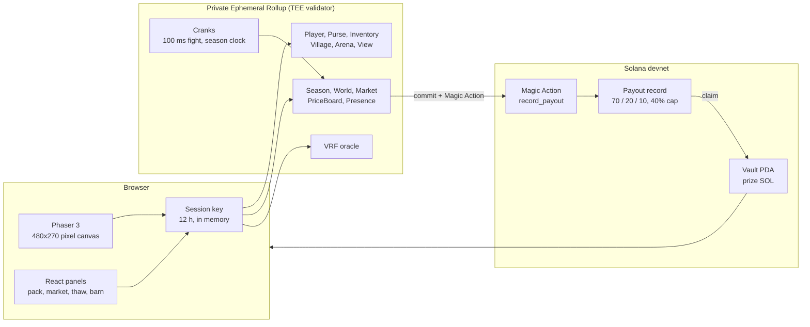

# Sunhoard

A 2D pixel RPG that runs on MagicBlock's Ephemeral Rollups. Chop, mine and fight with no wallet popup, thaw sealed
loot that was fixed the moment it dropped, trade it at a player market whose fee feeds the dragon's hoard, then climb
to the Noonless Crater and split the pot when Old Gloam falls.

**Devnet only.** Nothing here uses real money.

- Program: `FxqDh8g5KcZbEzg4AJsX5yUit6A63BC5PoncdWjtBKqS` (Solana devnet)
- Season clock: demo mode (a 10-minute Long Night), so the whole arc can be seen in one sitting
- Built for Solana Blitz v10, theme **Entertainment Finance**

## The story

Forty winters ago the dragon Old Gloam swallowed the sun. The light it spilled froze into **Magic Blocks**, sealed in
rimeshells under the frost. You are the new Keeper. Light the meadow, thaw what the frost sealed, take in cold
wanderers, trade at the Coldfair, and finally climb the Rime Stair to the Crater. When the wyrm dies the Sunhoard
opens, and every slayer claims a share of the SOL in the vault.

## Why MagicBlock

| What the game does | What runs it | Why it cannot be plain Solana |
|---|---|---|
| Every chop, swing, step, thaw and listing | Private Ephemeral Rollup, signed by a 12-hour session key | ~10 ms blocks, zero fees, no popup per action |
| Sealed rimeshells, quirks, private purses, Old Gloam's HP | Private ER accounts with per-account permissions | Account data is public on Solana; sealed loot would need a trusted server |
| Every drop, block, trait, villager and defuse | VRF, requested on the rollup | Fairness is verifiable, and even the developer cannot re-roll |
| Dungeon monsters at 10 Hz, the season clock, Pell's Wants | Cranks scheduled on the rollup | No game server to run or trust |
| The kill and the split | A Magic Action chained to the commit | The damage table and the payout record are written in one atomic step |
| The prize vault and the claim | Solana, never delegated | Custody stays on the base layer |



**Privacy is load-bearing, not decoration.** `World` holds the season salt and Old Gloam's HP and has no permission
members, so no wallet can read it. Each player's `Purse` and `View` are readable only by their owner. The Glare is
computed inside the enclave: it compares private purses and reveals only the pick.

**Two pots, two units.** The Sunhoard counter in the HUD is the **Glint hoard**: half of every market fee and the
stakes lost at the anvil. It lives on the rollup. When Old Gloam falls, `settle_season` freezes each slayer's share
of it (70% by damage, 20% equal, 10% to the killer, 40% cap) and `claim_glints` pays that into their private purse.
The **SOL prize** is a separate vault on Solana that the operator funds with devnet SOL. The Magic Action writes the
same split there, and `claim` pays it until the claim deadline. Trading grows the Glint hoard; it does not grow the
SOL prize.

**Sealing is two-step.** `crack` charges the fee and marks the shell; `crack_reveal`, in a later slot, recomputes
`key = sha256(salt, item id)`, checks `sha256(key) == commitment`, and writes the key and the gem into the slot. An
owner cannot simulate the reveal and sell only the duds, and anyone can verify a revealed block afterwards.

## Play it

1. Open the client and choose **Play on Solana devnet**. Connect Phantom or Solflare on devnet, or press **Use a
   guest key**: a throwaway devnet key kept in this browser. A new wallet needs 0.1 devnet SOL for account rent; the
   guest key asks the public faucet first.
2. **Enter the meadow** once. This signs up, delegates the six player accounts to the rollup, joins the season and
   creates a 12-hour session key. A wallet shows about six popups, a guest key none. After that nothing asks again.
3. Walk with WASD, **Space** to chop, mine, pick or talk, **E** for the pack.
4. Follow the first-night trail: the camp fire, the birch, Nell, the cellar hatch. Clear the Bramble Cellars, take the
   chest, thaw the shell at the Thawery and check the hash.
5. Sell, craft, equip, list at the Coldfair, strike the anvil, set a block in a lantern post.
6. When you are ready, enter the **Noonless Crater**. The wyrm has one HP pool for the whole season. When it dies the
   Magic Action writes the split on Solana; you claim your Glints on the rollup and your SOL from the vault, and the
   killer's Ember Egg names the next wyrm.

**Check the privacy claim yourself.** Once you are in, **Try to cheat** signs in to the rollup with a brand-new key
that has no rights and asks for the public Season, the sealed World (Old Gloam's HP and the loot seals) and your
purse. It shows what came back beside what your own key gets.

No wallet at all? **Practice combat** on the title screen runs the same fixed-step fight in the page. It sends
nothing and awards nothing, so a judge can feel the combat without a key.

## The demo (3 minutes)

| Time | Beat |
|---|---|
| 0:00 | The title over the live, snowbound meadow; the Sunhoard counter |
| 0:15 | Chop and mine with the rollup feed open; the aurora rises |
| 0:40 | Bramble Cellars: crank-ticked monsters, the Snuffer, the boss chest |
| 1:05 | Thaw a sealed rimeshell; the page recomputes the commitment hash |
| 1:25 | List it; a second wallet buys; 5% rises to the Sunhoard, half burns |
| 1:45 | The anvil: 62%, a crack, +5 heat, then the clean strike |
| 2:00 | Lantern posts light the barn; the Hearth Bell rings a wanderer in |
| 2:15 | The Crater; the Glare picks the warmer of two private purses |
| 2:40 | The kill: Noon Unbound, spring sweeps the map, Magic Action, both claims |
| 2:55 | The barn glowing with blocks, and what runs where |

Rare beats (a purple chest, a Legendary block) use the labelled **demo mode** odds and an admin `demo_grant`. The video
says so on screen. Played honestly, a Blazing block from a Small shell is far too rare to catch on camera.

## Run the client

Requires Node 24 and Yarn 1.

```sh
cd client
corepack yarn
corepack yarn dev
```

Open `http://127.0.0.1:5173/`. Copy `.env.example` to `.env.local` first if the program or endpoint changed; the
committed example points at devnet and the TEE validator.

## Build and test

```sh
# program
python3 economy/codegen/generate.py --check                # the Rust and browser tables match economy.json
anchor build                                               # the release binary, target/deploy/
cargo-build-sbf --manifest-path programs/sunhoard/Cargo.toml \
  --features debug --sbf-out-dir target/sbf-debug          # the debug binary the flows load
cargo +1.89.0 test --lib                                   # 66 rules tests
cargo +1.93.0 test --manifest-path tests-magicsvm-rs/Cargo.toml   # 5 end-to-end flows

# client
cd client
corepack yarn typecheck
corepack yarn test                                          # 43 tests
```

The flows need both binaries: four load `target/sbf-debug/sunhoard.so`, which adds `debug_grant` and `debug_kill`,
and one smoke-tests the release binary that is deployed.

The MagicSVM flows run the real program binary against an in-process Solana + rollup. They cover:

- `m1`: sign-up, delegation, join, session, gather + VRF callback, the two-step thaw, a cranked room, the Magic Action
  payout and a claim
- `l1`: the loop, six rooms, the Snuffer, the chest, crafting, Pell, eating and equipping
- `l2`: the market with the fee split, the anvil, the Glare, the Crater and a visit
- `l3`: a real kill, the Ember Egg, the season's Spring, naming the next wyrm, `settle_season`, the SOL share and
  the Glint share both paid, the claim deadline, and the next season opening with a fresh wyrm
- `release`: the deployed binary runs sign-up through the first gather

## Devnet setup (the operator)

The admin keypair and all env files are gitignored. The admin key lives outside the repo, at
`~/.config/solana/sunhoard-admin.json`.

```sh
# 1. deploy or upgrade (devnet only; rent is about 6 SOL). The public RPC drops uploads, so the
#    script keeps its buffer and resumes; run it again if it stops early.
./scripts/deploy-devnet.sh

# 2. create the shared accounts, delegate them, set permissions, open season 1 in demo mode
node --experimental-strip-types scripts/init-game.ts

# 3. check it
node --experimental-strip-types scripts/admin.ts status
```

`scripts/admin.ts` also has:

- `grant <wallet> gear <kind> <rarity>` and `grant <wallet> shell <size>`: labelled demo items, demo mode only
- `settle`: after Old Gloam falls, commits the season and runs the Magic Action that writes the split on Solana
- `next`: opens the next season. The program allows it only after the kill, after `settle`, and after Spring has
  ended (5 minutes in demo mode, a day live); Spring is the claim window. The damage table and Old Gloam's HP reset;
  the pot and the name the Ember Egg gave carry over. One payout record serves every season: the next settle
  overwrites it, and a share nobody claimed by then stays in the vault for the new pot
- `fund <sol>`: adds devnet SOL to the prize vault
- `schedule`: starts the season clock's crank. In demo mode the Long Night then ends after 10 minutes, so leave it
  off for a world that should stay open
- `demo on|off`

Everything is devnet-guarded and nothing prints a key or a token.

### Prove it live

`client/scripts/live.ts` drives the page's own chain code against devnet with a throwaway keeper, so every step the
browser takes can be checked without a wallet popup:

```sh
cd client
corepack yarn live enter      # sign up, delegate, join, session key
corepack yarn live gather     # a session-signed chop and its VRF bonus
corepack yarn live private    # a stranger's token must not read World
corepack yarn live cellar     # a room on the 100 ms crank
corepack yarn live crater     # fight Old Gloam
corepack yarn live claim      # claim the share on Solana
```

## Layout

```
programs/sunhoard/src/
  instructions/   one folder per feature: player, gather, craft, market, anvil, dungeon, lair, village, season
  logic/          pure Rust rules: the seal, gather, VRF rolls, the fixed-step fights, prices, the split
  state/          the 13 accounts, zero-copy, every one under 10 KB
tests-magicsvm-rs/  the four end-to-end flows
client/src/
  chain/          connections, TEE token, session key, tx queue, TxLog, program clients
  game/           Phaser: meadow, cellar, Crater, the opening and the quest
  ui/             React panels over the canvas
  art/            the procedural Magic Block and rimeshell renderer, audio
scripts/          deploy, init, admin, copy-idl
```

## Credits

Built with [MagicBlock](https://magicblock.gg)'s Ephemeral Rollups, VRF, cranks, private accounts and Magic Actions.
The examples at `magicblock-labs/magicblock-examples` were the reference for every MagicBlock API; `test-utils/rust`
is copied from there. Art and audio come from the CC0 packs listed in [ASSETS.md](ASSETS.md): Ninja Adventure
(Pixel-boy), Kenney Tiny Dungeon and Kenney audio, and Pixelify Sans (OFL). No MagicBlock logo, no art or music from
any other game.

Design notes live in the parent folder (`docs/`), outside this repository.
